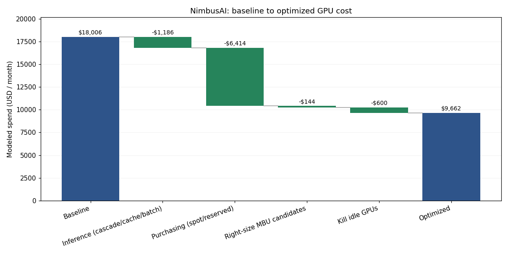

# NimbusAI — GPU Cost Optimization Report

**Period:** monthly

**Baseline spend:** $18,005.62

**Optimized spend:** $9,661.62

**Projected savings:** $8,344  (**46%**; chi tiết 46.34%)

## Savings by lever

| Lever | Savings (USD) |
|---|---|
| Inference (cascade/cache/batch) | $1,186 |
| Purchasing (spot/reserved) | $6,414 |
| Right-size MBU candidates | $144 |
| Kill idle GPUs | $600 |

## Sustainability

- Energy per query (modeled traffic average): 13.20 Wh
- Carbon per query (us-east-1): 5.015 gCO2e
- Lowest-carbon region: europe-north1
- Cheapest electricity region: us-east-wa

## Phạm vi và phương pháp

Dữ liệu tổng hợp seed=25, snapshot tháng 6/2026; quy đổi một ngày traffic thành 30 ngày. Đây là mô hình lập kế hoạch của lab. M3 và phần carbon dùng số ngày thực tế của từng job, giới hạn trong cửa sổ 30 ngày. Chọn tier reserved còn cần horizon nhu cầu dài hạn được khai báo riêng trong Extension 1. M5 làm tròn tiết kiệm mỗi lever tới USD trước khi cộng tổng; baseline không làm tròn sớm. Năng lượng/truy vấn là trung bình theo toàn bộ traffic, bao gồm reasoning, thay cho mẫu cố định 800 token trước đây.

## Chi phí inference theo $/1M-token

Phân tích 2,400 request/ngày, 7,533,027 token/ngày. Mẫu số gồm toàn bộ input + output token, kể cả input được cache; giữ nguyên ở mọi bước. Chi phí training/mua GPU được trình bày riêng, không đưa vào mẫu số token inference.

| Bước áp dụng | USD/ngày | $/1M-token | Tiết kiệm tăng thêm USD/ngày |
|---|---:|---:|---:|
| Baseline | 48.8742 | 6.4880 | 0.0000 |
| Cascade | 11.4756 | 1.5234 | 37.3985 |
| Cascade + cache | 11.1431 | 1.4792 | 0.3326 |
| Cascade + cache + batch | 9.3290 | 1.2384 | 1.8141 |

Inference giảm **80.9%**. Các khoản tiết kiệm tăng thêm tính tuần tự cascade → cache → batch, tránh cộng trùng phần chiết khấu.

Trong mô hình discount_stack, input cache toàn bộ còn 10% giá, rồi batch còn 50%: 0,50 × 0,10 = 0,05, tương đương giảm 95% phần input này. Output token và tiền ghi cache vẫn phải tính riêng; 95% không phải mức giảm toàn bộ hóa đơn của dataset. Batch phù hợp với eval/xử lý nền có thể chờ, không phù hợp với chat hoặc truy vấn có yêu cầu latency thấp và phản hồi tức thì.

## Kiểm toán GPU-Util lie

| GPU | GPU-Util | MFU | MBU |
|---|---:|---:|---:|
| gpu-h100-4 | 98.2% | 0.194 | 0.207 |
| gpu-a10g-1 | 96.9% | 0.268 | 0.302 |

GPU-Util đo tỷ lệ thời gian có kernel chạy, còn MFU đo FLOPs đạt được so với peak. GPU bận có thể vẫn sử dụng ít năng lực tính toán do chờ bộ nhớ, kernel nhỏ hoặc overhead. Telemetry này phát hiện triệu chứng; cần profiler để xác nhận nguyên nhân.

M5 dùng right-sizing đáp ứng VRAM/bandwidth ở Extension 2, tiết kiệm **$144/tháng**. Không suy ra khả năng hạ GPU chỉ từ MFU thấp. GPU idle gây lãng phí **$20.00/ngày**, tương đương **$600/tháng**, chiếm **3.33% baseline M5**. GPU thay thế cần kiểm tra VRAM, băng thông, throughput và latency trước khi thực hiện.

## M4 — Phân bổ chi phí và FOCUS

| Team | USD/ngày | Tỷ lệ chi phí inference |
|---|---:|---:|
| assistant | 3.0330 | 32.51% |
| search | 2.5465 | 27.30% |
| rag | 1.9331 | 20.72% |
| eval | 1.8165 | 19.47% |

Team **assistant** tốn nhiều nhất: **$3.0330/ngày (32.51%)**. Tag coverage (đủ team và project) là **91.79%**, đủ ngưỡng 80% để chargeback theo gate của lab. Còn **197 / 2400 request** thiếu tag bắt buộc; cần bổ sung để phân bổ chi phí theo project chính xác hơn.

FOCUS chuẩn hóa tên cột, đơn vị tiền và thông tin kỳ tính phí giữa các nhà cung cấp, giúp tổng hợp/so sánh chi phí nhiều cloud mà giảm công sức xử lý schema riêng. focus_export.csv của lab là mẫu **50 dòng đầu**, theo schema FOCUS-style đơn giản hóa; không phải toàn bộ 2.400 request hay chứng nhận tuân thủ đầy đủ một phiên bản FOCUS.

## Extension 1 — Chính sách mua GPU

Policy chọn phương án có chi phí thấp nhất trên toàn bộ thời gian nhu cầu dự kiến. Spot tính thêm 3% checkpoint và 0,5 giờ làm lại mỗi interruption. Reserved tính đủ 24 giờ/ngày cho toàn bộ kỳ 365 hoặc 1.095 ngày, kể cả phần nhàn rỗi và gia hạn nguyên kỳ.

Effective GPU-hours = productive GPU-hours × (1 + 0,03 + interruption_rate × 0,5). Phần giờ tăng thêm trả cho checkpoint và làm lại công việc mất khi spot bị thu hồi. Với H100 rate giả định 2%/giờ, multiplier là 1,04: cần thêm 4% GPU-hours, dù sản lượng công việc hữu ích giữ nguyên.

Giả định các workload inference không gián đoạn tiếp tục có nhu cầu **1095 ngày**; đây là tham số planning, không phải dữ kiện trong CSV. Job khác dùng days của dataset. Tiền trong cửa sổ 30 ngày dùng min(days,30); chi phí cả horizon/cam kết trình bày riêng, không coi là chi phí của một tháng.

| Job | Ngày trong cửa sổ | Horizon nhu cầu (ngày) | Tier mới | Chi phí cửa sổ USD | Chi phí cả horizon/cam kết USD |
|---|---:|---:|---|---:|---:|
| job-train-llm | 14 | 14 | spot | 3494.40 | 3,494.40 |
| job-train-embed | 5 | 5 | spot | 233.20 | 233.20 |
| job-finetune | 3 | 3 | spot | 56.16 | 56.16 |
| job-infer-chat | 30 | 1095 | reserved_3yr | 2592.00 | 94,608.00 |
| job-infer-rag | 30 | 1095 | reserved_3yr | 2160.00 | 78,840.00 |
| job-infer-search | 30 | 1095 | reserved_3yr | 1296.00 | 47,304.00 |
| job-dev-sandbox | 22 | 22 | spot | 153.47 | 153.47 |
| job-batch-eval | 30 | 30 | spot | 140.40 | 140.40 |

So sánh policy trên cùng số ngày và cùng cách tính reserved đủ giờ calendar: policy cũ **$10,172.84 (38.49% tiết kiệm)**; policy mới **$10,125.63 (38.78%)**; giảm thêm **$47.21** trong cửa sổ này. Cách prorate reserved theo giờ thực dùng trước đây còn bỏ sót **$324.00** tiền GPU idle phải trả.

| GPU | Interruption rate/giờ giả định |
|---|---:|
| H100 | 2% |
| H200 | 2% |
| A100 | 6% |
| A10G | 12% |
| L4 | 8% |
| B200 | 3% |
| MI300X | 5% |

Các rate là giả định thử nghiệm, không phải dữ liệu thu hồi spot đo được. [tier_policy_matrix.csv](tier_policy_matrix.csv) có 126 tình huống GPU × duty cycle × interruptible × horizon.

| Horizon inference giả định | Chi phí cửa sổ USD | Các tier inference online |
|---|---:|---|
| 30 ngày | 13,992.03 | job-infer-chat: on_demand; job-infer-rag: on_demand; job-infer-search: on_demand |
| 365 ngày | 12,285.63 | job-infer-chat: reserved_1yr; job-infer-rag: reserved_1yr; job-infer-search: on_demand |
| 1095 ngày | 10,125.63 | job-infer-chat: reserved_3yr; job-infer-rag: reserved_3yr; job-infer-search: reserved_3yr |

Insight: horizon ngắn có thể chọn on-demand; 1 năm và 3 năm có mức cam kết khác nhau. Chỉ dùng giả định nhu cầu dài hạn khi có bằng chứng kinh doanh. Giá reserved thấp nhất theo giờ chưa đủ để kết luận tổng hợp đồng rẻ nhất.

## Extension 2 — Right-sizing theo MBU

Xét workload infer/embed có MBU < 70%. MBU thấp không tự chứng minh memory-bound; đây là kịch bản inference/decode cần xác nhận bằng profiler. VRAM yêu cầu = peak mem_used_gb × 1.10; bandwidth yêu cầu = peak achieved_bw_tbs / 0.70. GPU đề xuất phải đủ cả hai và có giá giờ thấp hơn GPU hiện tại.

| GPU catalog | VRAM GB | Peak TB/s | USD/GPU-giờ | USD/GB-VRAM-giờ |
|---|---:|---:|---:|---:|
| H100 | 80 | 3.35 | 2.50 | 0.03125 |
| H200 | 141 | 4.80 | 3.95 | 0.02801 |
| A100 | 80 | 2.00 | 1.79 | 0.02237 |
| A10G | 24 | 0.60 | 1.00 | 0.04167 |
| L4 | 24 | 0.30 | 0.80 | 0.03333 |
| B200 | 192 | 8.00 | 5.09 | 0.02651 |
| MI300X | 192 | 5.30 | 1.95 | 0.01016 |

| GPU hiện tại | Đề xuất | VRAM cần GB | Peak BW cần TB/s | Peak BW GPU đề xuất | USD/GB trước → sau | Tiết kiệm USD/tháng | % |
|---|---|---:|---:|---:|---|---:|---:|
| gpu-a100-0 (A100) | A100 | 74.47 | 1.010 | 2.00 | 0.02237 → 0.02237 | 0.00 | 0.0% |
| gpu-a100-1 (A100) | A100 | 73.70 | 0.967 | 2.00 | 0.02237 → 0.02237 | 0.00 | 0.0% |
| gpu-a10g-0 (A10G) | L4 | 22.33 | 0.260 | 0.30 | 0.04167 → 0.03333 | 144.00 | 20.0% |
| gpu-a10g-1 (A10G) | A10G | 22.44 | 0.303 | 0.60 | 0.04167 → 0.04167 | 0.00 | 0.0% |
| gpu-l4-0 (L4) | L4 | 22.22 | 0.169 | 0.30 | 0.03333 → 0.03333 | 0.00 | 0.0% |

Tổng các ứng viên inference/embedding: **$4,593.60 → $4,449.60/tháng**, giảm **$144.00 (3.13%)** ở giá on-demand. Dòng không đổi GPU nghĩa là không có GPU rẻ hơn đáp ứng cả VRAM và bandwidth; không ép chọn GPU rẻ nhất.

Cần benchmark throughput, p95 latency, kernels và độ chính xác trước khi migrate. M5 dùng khoản này một lần trong lever Right-size MBU candidates, không cộng lại ở phần extension. Vẫn cần mapping resource/job để loại trừ phần trùng với purchasing trước khi dự báo hóa đơn thực.

## Extension 3 — Cache có đáng chi phí ghi?

Dataset được sinh thêm cached_prefix_id và avg_cache_reads mà không thay đổi các cột token/tier gốc hoặc tiêu thụ thêm RNG. Prefix mô phỏng được nhóm theo team, tier và cửa sổ 12 request; avg_cache_reads là số request đọc prefix đó. Không có nội dung prompt để xác minh các prefix thực sự trùng nhau; metadata này là giả định có thể tái lập.

Một lần ghi được giả định tính 1.25× giá input thường, phân bổ trên số lần đọc. Cache read tính 10% giá input; batch giảm 50% phần request, không giảm chi phí ghi. Gate: reads × input_price_after_batch × 0,9 > write_price. Bằng đúng hòa vốn thì không áp cache.

| Model tier | Reads trung bình/request | USD/1M-token ghi | Hòa vốn reads realtime | Hòa vốn reads batch | Request cache | Request bỏ cache |
|---|---:|---:|---:|---:|---:|---:|
| small | 3.295 | 0.25 | 1.389 | 2.778 | 1621 | 281 |
| large | 1.695 | 3.75 | 1.389 | 2.778 | 219 | 279 |

Có 1101 prefix mô phỏng; **1840 request áp cache**, **560 request bỏ cache**. Ghi phân bổ **$0.3810/ngày**. Không cache (vẫn cascade + batch): **$9.6586/ngày**; gate + ghi: **$9.3290/ngày**; tiết kiệm cache ròng **$0.3296/ngày**.

Cách cũ áp cache cho mọi request và bỏ qua tiền ghi cho ra **$8.4846/ngày**. Mô hình mới có thể đắt hơn con số đó vì bổ sung chi phí đã bị bỏ sót. M2, M4, FOCUS và reasoning dùng cùng hàm tính tiền để giữ số liệu nhất quán. Cache prefix có độ dài biến đổi được mô hình hóa theo chi phí ghi phân bổ/token; đây không phải mô phỏng cache byte-for-byte.

## Extension 4 — Ngân sách reasoning

| Nhóm | Request/ngày | % traffic | USD/ngày | % chi phí | Wh/ngày | % năng lượng |
|---|---:|---:|---:|---:|---:|---:|
| reasoning | 201 | 8.375% | 1.4077 | 15.09% | 29787.74 | 94.04% |
| standard | 2199 | 91.625% | 7.9214 | 84.91% | 1887.56 | 5.96% |

Chi phí USD dùng route_tier, số token, cache và batch thực tế. Hệ số 80× của lab chỉ áp dụng cho năng lượng; không nhân giá token với 80. Số output token reasoning đã dài hơn trong dataset, không nhân thêm lần nữa.

Nếu cùng các token reasoning chạy trên model small không reasoning, chi phí là $0.2017/ngày và năng lượng 372.35 Wh/ngày. Chênh lệch hiện tại là **$1.2059/ngày** và **29415.40 Wh/ngày**. Đây là so sánh cùng số token, chưa đo chất lượng.

| Giới hạn reasoning / tổng traffic | Request giữ lại | Request chuyển small | USD/ngày sau | USD/ngày tiết kiệm | Wh/ngày tiết kiệm |
|---|---:|---:|---:|---:|---:|
| 10% | 201 | 0 | 9.3290 | 0.0000 | 0.00 |
| 5% | 120 | 81 | 9.0889 | 0.2401 | 7612.01 |

Giữ request reasoning có tổng token dài nhất trước, dùng thứ tự dòng làm tie-breaker. Request vượt giới hạn chuyển sang small, tắt reasoning và giữ nguyên token/cache/batch. Độ dài chỉ là proxy cho kịch bản; dữ liệu không có complexity score hoặc nhãn chất lượng.

Quy tắc đề xuất: chỉ bật reasoning cho task cần suy luận nhiều bước khi model small chưa đạt ngưỡng chất lượng; theo dõi quota theo ngày. Giới hạn 10% là guardrail; thử nghiệm 5% trên eval và kiểm tra chất lượng trước khi áp dụng. Kịch bản không tăng model small lên large.

## Extension 5 — Lịch chạy theo carbon

Chỉ xét job interruptible=1. Công thức: kWh = watts × số GPU × giờ/ngày × min(days, 30) / 1000; gCO2e = kWh × cường độ carbon vùng. Công suất dùng catalog, chưa gồm máy chủ, PUE, truyền dữ liệu và overhead checkpoint/rework.

| Job | Số ngày | GPU-giờ | kWh | kgCO2e hiện tại | kgCO2e vùng sạch | kgCO2e giảm |
|---|---:|---:|---:|---:|---:|---:|
| job-train-llm | 14 | 2240 | 1568.00 | 595.84 | 47.04 | 548.80 |
| job-train-embed | 5 | 200 | 80.00 | 30.40 | 2.40 | 28.00 |
| job-finetune | 3 | 36 | 25.20 | 9.58 | 0.76 | 8.82 |
| job-dev-sandbox | 22 | 352 | 52.80 | 20.06 | 1.58 | 18.48 |
| job-batch-eval | 30 | 90 | 63.00 | 23.94 | 1.89 | 22.05 |

Tổng 5 job, **1,789.00 kWh**. Chuyển từ us-east-1 sang europe-north1 giảm **626.15 kgCO2e (92.11%)** và giảm phần điện ước tính **$53.67** trong cửa sổ job này.

| Vùng | USD/kWh | gCO2e/kWh | Tiền điện USD | Carbon kgCO2e | Điểm cân bằng |
|---|---:|---:|---:|---:|---:|
| us-east-1 | 0.120 | 380 | 214.68 | 679.82 | 1.000 |
| us-west-2 | 0.070 | 120 | 125.23 | 214.68 | 0.450 |
| europe-north1 | 0.090 | 30 | 161.01 | 53.67 | 0.414 |
| europe-central2 | 0.180 | 660 | 322.02 | 1180.74 | 1.618 |
| us-east-wa | 0.055 | 90 | 98.39 | 161.01 | 0.348 |

Điện rẻ nhất: **us-east-wa**; carbon thấp nhất: **europe-north1**; phương án cân bằng: **us-east-wa**. Điểm cân bằng = 0,5 × (giá điện / giá điện baseline) + 0,5 × (carbon intensity / carbon intensity baseline), thấp hơn tốt hơn; đây là trọng số giả định. Chọn vùng còn phụ thuộc GPU sẵn có, thời hạn job, vị trí dữ liệu, phí truyền và latency.

## Ba hành động ưu tiên

1. Rà soát mua spot/reserved vì đóng góp $6,414/tháng, lớn nhất trong mô hình; xác nhận checkpoint, duty cycle và thời hạn cam kết.
2. Áp dụng cascade → cache → batch cho request phù hợp; dùng $/1M-token và chất lượng làm chỉ số đánh giá, theo dõi reasoning quota trên traffic eval.
3. Tự động tắt GPU idle, profile hai GPU bị flag, rồi thử right-size và chuyển job interruptible sang vùng phù hợp ưu tiên carbon/điện.

## Giả định và giới hạn của tổng tiết kiệm

Tổng 4 lever giữ cách tổng hợp của M5. Telemetry không có khóa liên kết với workloads, nên mô hình giả định right-size/idle độc lập với purchasing; chưa chứng minh các savings không trùng nhau trên một hóa đơn thực. M3 đã tính đủ cam kết reserved, nhưng horizon nhu cầu inference dài hạn là giả định; cần xác minh trước khi mua. Cần dựng baseline theo từng resource/job trước khi dự báo chi phí thực tế.

Right-sizing MBU đã tính một lần trong 4 lever. Kịch bản reasoning và phần tiền điện theo vùng được trình bày bổ sung, không cộng vào 4 lever để tránh cộng trùng hoặc coi tiền điện là khoản giảm hóa đơn cloud. Năng lượng/carbon là ước tính mô hình, không phải số đo điện thực tế. Tất cả giá/vùng sử dụng hằng số trong repo, không phải bảng giá hiện hành.

## Tái lập kết quả

```powershell
.\.venv\Scripts\python.exe -X utf8 missions/run_all.py
.\.venv\Scripts\python.exe -X utf8 verify.py
.\.venv\Scripts\python.exe -X utf8 -m pytest -q -p no:cacheprovider tests extension_tests
```

Dữ liệu chi tiết: [analysis.json](analysis.json). Bài viết gợi ý: [writeup_suggested.md](writeup_suggested.md). Checklist hoàn thiện: [report_completion_guide.md](report_completion_guide.md).



_Figures are June-2026 as-of snapshots; re-baseline before acting._